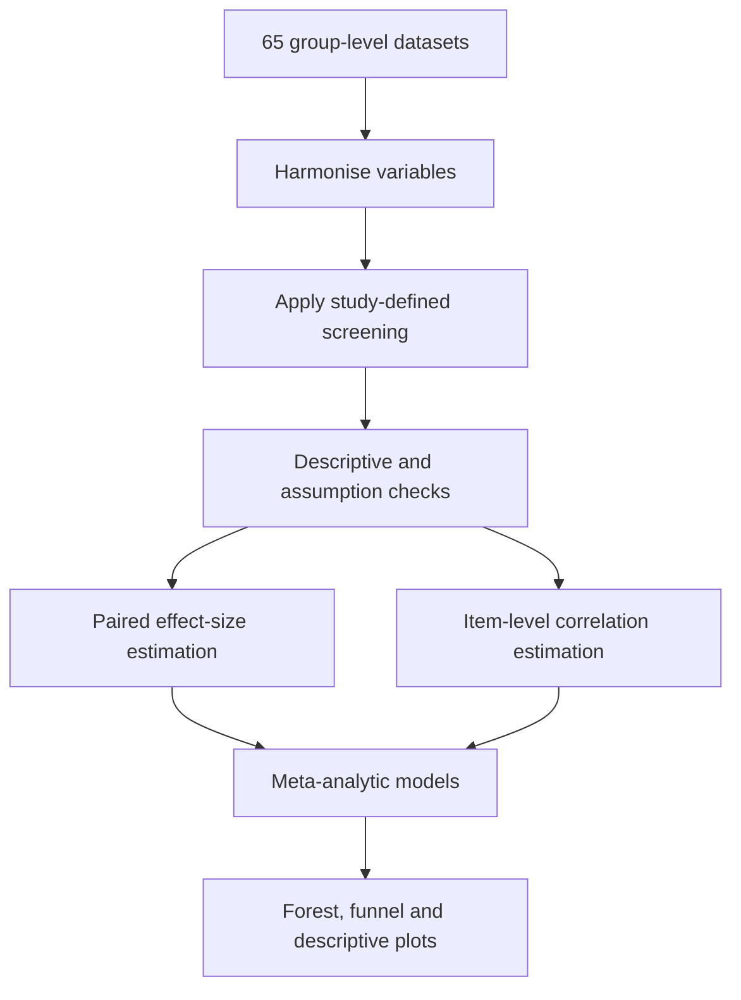

# Animacy, Interactive Imagery, and Memory: Meta-Analysis

An R analysis of 65 replication groups from English- and Dutch-language versions of a memory experiment. The project examines animacy-related recall, interactive-imagery ratings, and the association between item-level interaction ratings and recall.

## Research questions

1. Do participants recall different numbers of animate and inanimate words?
2. Do animate and inanimate items differ in their interaction ratings?
3. Are item-level interaction ratings associated with recall proportions?
4. Do paired recall patterns differ across the two language groups?

## Analysis workflow



## Methods

- Combine group-level CSV files and harmonise analysis variables.
- Apply the study's predefined outlier-screening rules.
- Conduct paired comparisons for recall and interaction ratings.
- Calculate paired standardized mean-change effects using `metafor`'s `SMCC` measure.
- Fit an equal-effects model for the animacy–recall comparison and random-effects models for interaction ratings and item-level correlations.
- Apply Fisher's r-to-z transformation (`ZCOR`) before pooling correlations.
- Produce forest plots, funnel plots, and descriptive visualisations.

## Implementation

- **Language:** R
- **Main script:** `animacy_memory_meta_analysis.R`
- **Core meta-analysis package:** `metafor`

```r
install.packages(c(
  "ggpubr", "ggplot2", "gplots", "psych", "tidyverse",
  "rstatix", "apaTables", "ez", "gtsummary", "car",
  "metafor", "plyr", "effsize", "gridExtra"
))
```

## Input data

The script expects 65 CSV files in the working directory, named `group1.csv` through `group65.csv`. The files must follow the original study's variable schema. Participant-level source data are not included.

## Interpretation and limitations

Paired comparisons use complete pairs within each group. The item-level correlation analysis is based on 24 stimulus items, not the participant count. The original data are required to reproduce numerical results.

The outlier rules, dependence structure of item-level observations, and sampling-variance assumptions should be reviewed before treating pooled estimates as definitive. The README describes the implemented workflow; it does not substitute for a full methodological audit of the original analysis.

## Related work

The [Replication Processing Pipeline](https://github.com/MahdiMoocavi/Replication-Processing-Pipeline) contains preprocessing code for a related animacy replication dataset.
